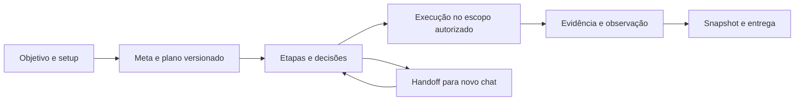

<div align="center">

# Kommo Engineer

**Estratégia comercial, engenharia de CRM e continuidade de projetos para Kommo.**

[Começar](#começar) · [Capacidades](#o-que-a-skill-pode-fazer) · [Comandos](#comandos-da-cli) · [Documentação](#mapa-da-documentação)

**0.5.0-rc.1** · Agent Skills · Python 3.11+ · Conteúdo em português

</div>

Kommo Engineer ajuda um agente a transformar objetivos comerciais em processos, configurações e integrações verificáveis. Reúne conhecimento de CRM, Salesbot, IA e RevOps com uma CLI para manter setup, metas, decisões, evidências e entregas entre conversas.

> **Estado da versão:** os utilitários foram testados offline. O cliente HTTP é experimental e suas escritas ficam desativadas por padrão. Desenhos de Salesbot são especificações, não arquivos automaticamente importáveis. A versão 1.0 depende de homologação de CRM e testes nas plataformas previstas.

## Índice

1. [Para quem é](#para-quem-é)
2. [O que a skill pode fazer](#o-que-a-skill-pode-fazer)
3. [O que está implementado](#o-que-está-implementado)
4. [Começar](#começar)
5. [Menu e exemplos de pedidos](#menu-e-exemplos-de-pedidos)
6. [Setup com 18 campos](#setup-com-18-campos)
7. [Metas e continuidade entre chats](#metas-e-continuidade-entre-chats)
8. [Salesbot e biblioteca visual](#salesbot-e-biblioteca-visual)
9. [API, MCP e integrações](#api-mcp-e-integrações)
10. [Agentes de IA e operação comercial](#agentes-de-ia-e-operação-comercial)
11. [Relatórios e treinamento](#relatórios-e-treinamento)
12. [Comandos da CLI](#comandos-da-cli)
13. [Estrutura do projeto](#estrutura-do-projeto)
14. [Testes e critérios de lançamento](#testes-e-critérios-de-lançamento)
15. [Mapa da documentação](#mapa-da-documentação)
16. [Limites e segurança](#limites-e-segurança)
17. [Contribuir e fontes](#contribuir-e-fontes)

## Para quem é

- Consultores e implementadores que desenham operações no Kommo.
- Gestores comerciais que precisam definir funil, responsabilidades, cadências e indicadores.
- Equipes técnicas que integram Kommo a canais, planilhas, automações e agentes de IA.
- Pessoas que precisam retomar implementações em novos chats sem perder decisões e planos.

A skill responde perguntas pontuais diretamente. Setup, metas e snapshots são recursos para trabalho recorrente; não são exigências para tirar uma dúvida.

## O que a skill pode fazer

As capacidades abaixo incluem **orientação especializada**, **ferramentas locais** e **execução condicionada a acesso e homologação**. A tabela seguinte distingue esses níveis.

| Área | Como ajuda |
|---|---|
| Estratégia e discovery | Entender negócio, oferta, ICP, jornada, objetivos, gargalos, restrições e critérios de sucesso. |
| Desenho do CRM | Definir entidades, campos, tags, tarefas, funis, etapas, responsáveis e critérios observáveis de avanço. |
| Diagnóstico de conta | Investigar acesso, plano, permissões, dados, duplicidade, integrações e divergências entre API e interface. |
| Operação de vendas | Apoiar qualificação, pipeline, priorização, forecast, ganhos/perdas, cadência e próxima ação por responsável. |
| Ciclo do cliente | Desenhar onboarding, acompanhamento, retenção, risco e expansão. |
| Salesbot | Planejar triagem, qualificação, follow-up, biblioteca manual, macros, ramificações, gatilhos e transferência humana. |
| IA nativa e externa | Definir persona, conhecimento, ações, supervisão, RAG, memória, limites e fallback. |
| Integrações | Especificar contratos de webhooks, n8n, MCP, chats, canais, mídia, formulários, planilhas e widgets. |
| Engenharia de dados | Planejar importação, migração, sincronização, conflitos, extração incremental e evolução de schema. |
| RevOps e análise | Definir lifecycle, conversão, origem, velocidade, tempo em etapa, reentrada e SLA. |
| Gestão de implementação | Registrar setup, metas, etapas, dependências, planos versionados, decisões e prompts de retomada. |
| Entrega | Consolidar relatório, treinamento e playbook com evidências e estado de homologação. |

## O que está implementado

| Recurso | Estado do candidato |
|---|---|
| CLI de projeto, setup e continuidade | Implementada; testes offline. |
| Seleção de metas, etapas, planos, decisões e handoffs | Implementada; testes offline. |
| Aceite por evidência + observação explícita | Implementado; não autentica sozinho a verdade semântica do resultado. |
| Relatórios cumulativos com versões imutáveis | Implementados; treinamento depende dos registros e evidências da conta. |
| Busca de procedimentos e interface | 83 entradas; 39 capturas documentadas, 26 imagens únicas por hash e 17 fichas de nós. |
| Escolha de método | Implementada como recomendação contextual; distingue solução funcional de implantação. |
| Cliente HTTP e inventário | Implementados com testes de transporte simulado; homologação remota pendente. |
| Criar/editar campos, funis e etapas via HTTP | Fatia limitada implementada, desligada por padrão, sem homologação operacional. |
| Gerador de receitas Salesbot | Gera desenho offline não importável; não publica nem ativa bots. |
| Fluxo composto Instagram → IA → vendedor → CRM | Contrato de arquitetura documentado; execução integrada pendente. |
| Acesso MCP e cofre Windows | Guia e helpers incluídos; conexão depende do servidor, cliente e conta usados. |
| Codex, Claude Code e Antigravity | Adaptadores documentados; testes reais de duas conversas por ambiente pendentes. |

Veja a [matriz de certificação](kommo-engineer/docs/certification.json) e o [relatório de verificação](kommo-engineer/docs/validation-results.md).

## Começar

### Instalar no Codex

Copie **a pasta inteira** `kommo-engineer` para a raiz de skills do Codex. Se já houver instalação, preserve uma cópia e compare o pacote antes de atualizar. Não basta copiar `SKILL.md`.

```powershell
git clone https://github.com/giuliacarv/kommo-engineer.git
# Destino global padrão; adapte caso CODEX_HOME esteja configurado.
Copy-Item -LiteralPath .\kommo-engineer\kommo-engineer -Destination "$env:USERPROFILE\.codex\skills\kommo-engineer" -Recurse
```

O exemplo de cópia pressupõe destino ausente. Em uma instalação existente, faça backup e atualização controlada. Reabra a conversa ou recarregue o seletor para descobrir a skill.

Ative com **`$kommo-engineer`** e descreva seu objetivo. Os utilitários usam **Python 3.11+**; use `python`, `python3` ou outro executável realmente instalado. O launcher `py` não está presente em todo Windows. Node é necessário apenas para os helpers JavaScript e para um servidor MCP que o exija.

### Outros ambientes

| Ambiente | Guia |
|---|---|
| Codex | [Instalação e diferenças](kommo-engineer/adapters/codex/README.md) |
| Claude Code | [Pasta de skills e invocação](kommo-engineer/adapters/claude-code/README.md) |
| Antigravity | [Modalidades app, CLI e IDE](kommo-engineer/adapters/antigravity/README.md) |

Cada ambiente mantém suas permissões de shell, arquivos e navegador. Adaptador documentado não equivale a instalação ou smoke confirmado.

## Menu e exemplos de pedidos

| Opção | Trabalho |
|---|---|
| 1 | Configurar projeto |
| 2 | Diagnóstico |
| 3 | Planejar implementação |
| 4 | Executar tarefa |
| 5 | Salesbots e IA |
| 6 | API e integrações |
| 7 | Metas e continuidade |
| 8 | Auditoria |
| 9 | Relatórios e treinamento |
| 0 | Ajuda |

Pedidos claros seguem diretamente para o assunto. Em decisões materiais, a skill pode apresentar alternativa econômica, intermediária e de maior controle, além de explicar, adiar ou escolher tecnicamente.

```text
$kommo-engineer Diagnostique por que os leads param na etapa de proposta.
$kommo-engineer Desenhe um funil com critérios de entrada e saída por etapa.
$kommo-engineer Compare API e interface para criar um campo de qualificação.
$kommo-engineer Planeje um Salesbot de triagem com fallback humano.
$kommo-engineer Configure o acesso MCP sem colocar token no arquivo do cliente.
$kommo-engineer Retome a META-002 a partir dos arquivos deste projeto.
$kommo-engineer Gere um playbook com o que já foi homologado e as pendências.
```

## Setup com 18 campos

A entrevista começa por: **“O que você quer que mude no resultado da sua empresa após implementar o Kommo?”**

O [contrato de setup](kommo-engineer/schemas/setup-fields.json) conserva 18 campos: `role`, `skill_level`, `business`, `product`, `delivery`, `sales_process`, `goal`, `expectations`, `acceptance`, `restrictions`, `budget`, `permissions`, `tools`, `plan`, `channels`, `account`, `integrations` e `priority`.

- Perguntas e exemplos se adaptam ao contexto sem eliminar campos obrigatórios.
- Respostas ficam como pendentes, propostas, confirmadas, adiadas ou inaplicáveis, conforme o contrato.
- Uma proposta não se torna fato confirmado automaticamente.
- O resumo em Markdown é derivado de `project.json`; o backlog inicial é uma proposta.
- Informação técnica desconhecida bloqueia somente a tarefa que depende dela.

## Metas e continuidade entre chats



Cada meta usa ID estável `META-NNN`; as etapas usam IDs como `META-001/E00`. Criar uma meta nova preserva a seleção anterior. Revisões criam `plan-v002.md`, `plan-v003.md` e assim por diante, sem apagar versões anteriores.

Decisões registram disposição, justificativa e impacto. Uma escolha rejeitada não vira pendência automaticamente. Dependências podem se referir a critérios específicos; dispensa exige motivo, e ciclos são recusados.

`goal handoff` gera o prompt com caminhos e estado reais. O agente seguinte consulta os arquivos pertinentes em vez de depender da transcrição da conversa. Reabrir uma meta conserva snapshots anteriores e exige novo aceite.

**Anexo não é aprovação:** `goal accept` registra `evidence_attached`; `goal observe` registra método, resultado e nível do teste. O fechamento exige observações e integridade. Snapshot documental não é backup restaurável da conta Kommo.

## Salesbot e biblioteca visual

A biblioteca recupera procedimentos por nomes de menus, aliases, relações, pré-requisitos e capturas. Declara explicitamente quando um submenu não foi observado.

As 17 fichas cobrem: enviar mensagem, reação, comentário, mensagem interna, mensagem em lista, condição de IA, pausa, inscrição Meta, ação, condição, validação, ir para outra etapa, iniciar Salesbot, código adaptado, widget, Round Robin e parar Salesbot.

```powershell
python -X utf8 kommo-engineer/scripts/ke.py knowledge find --query "Condição > Definir campo > Contato"
python -X utf8 kommo-engineer/scripts/ke.py knowledge find --query "qual gatilho escolher?"
```

O gerador oferece sete receitas: triagem, qualificação, follow-up, Instagram, biblioteca manual, handoff de IA e macro de vendedor. Inclui preflight e cenários de falha. A conversão para um editor real exige schema, IDs, canal, backup e teste controlado.

Consulte [receitas](kommo-engineer/references/salesbot-recipes.md), [auditoria de grafos](kommo-engineer/references/automation/salesbot-graph-audit.md) e [catálogo](kommo-engineer/references/knowledge/catalog.json).

## API, MCP e integrações

### Cliente HTTP

O cliente consulta identidade, leads, contatos, empresas, campos, funis, etapas e bots. Leituras de registros retornam projeções reduzidas; o inventário persiste metadados por conta e data. Identidade não comprova permissão de escrita.

Inclui allowlist de endpoints, host HTTPS exato, bloqueio de redirects, paginação limitada, tratamento de erros e retries limitados de leitura. O plano de alteração compara estado e conflitos. A aplicação exige escopo explícito, conta vinculada, habilitação no ambiente e pós-leitura.

Escritas ficam desligadas por padrão. A fatia publicada permite operações limitadas de campos, funis e etapas; não inclui exclusão, envio de mensagens ou publicação de definições completas de bot. Timeout ambíguo gera journal e bloqueia novas escritas até reconciliação.

[Executor HTTP e comandos](kommo-engineer/references/api-executor.md) · [Contratos de capacidade](kommo-engineer/references/knowledge/contracts/capabilities.json)

### Acesso por MCP

O [guia de acesso MCP](kommo-engineer/references/integrations/mcp-access-setup.md) cobre integração privada, cofre Windows, servidor, registro em Codex/Claude Code/Antigravity e confirmação de identidade. Os helpers de cofre e launcher estão em `scripts/`.

Skill, servidor, credencial e conexão ativa são componentes diferentes. Use somente ferramentas realmente expostas na sessão. Não cole tokens no chat nem em arquivos de configuração do cliente.

### Integrações e engenharia

- Webhooks com origem, elegibilidade, idempotência, observabilidade e recuperação.
- n8n com verificação de nó, versão, credenciais e expressões antes de importar.
- Sincronização com Google Sheets, conflito por campo e proteção da fonte original.
- Widgets React, manifest, callbacks, i18n e pacote.
- Extração incremental, schema drift e modelagem para BI.
- Fluxos de canal com plano, permissões, janela, templates e exclusões confirmados na conta.

## Agentes de IA e operação comercial

A skill ajuda a decidir entre regra determinística, Salesbot, IA nativa, agente externo, integração ou revisão humana. Os guias cobrem fontes de conhecimento, persona, ações, qualificação, suporte, agenda, voz, RAG, memória, confiança e handoff.

Na operação comercial, relaciona qualificação, responsável, tarefa, etapa, SLA e próxima ação. Pode orientar análise de ganhos/perdas, velocidade, retenção e expansão. Métricas e forecast exigem critérios e dados observados; desconhecido continua desconhecido.

Disponibilidade de IA, créditos, planos e recursos de canal depende do produto e da conta atuais. Os guias não habilitam funções por si mesmos.

## Relatórios e treinamento

Registros de entrega alimentam três documentos:

| Documento | Conteúdo |
|---|---|
| `relatorio.md` | Situação anterior, objetivo, solução, entregas, evidências e limites. |
| `treinamento.md` | Operação por papel, tarefas diárias, erros comuns e FAQ dos recursos comprovados. |
| `playbook.md` | Consolidação do contexto e do manual operacional. |

Cada geração conserva uma release imutável e atualiza os aliases correntes. Recursos preparados ou testados offline aparecem com homologação pendente. O gerador não inventa implantação, ROI ou resultado comercial.

## Comandos da CLI

Execute a partir da raiz do repositório. Os caminhos abaixo apontam para o pacote publicado; ajuste o prefixo se usar uma instalação global.

```powershell
python -X utf8 kommo-engineer/scripts/ke.py --help
python -X utf8 kommo-engineer/scripts/ke.py menu
python -X utf8 kommo-engineer/scripts/ke.py doctor
```

| Grupo | Ações |
|---|---|
| `project` | `init`, `status`, `validate`, `resume`, `migrate` |
| `setup` | `status`, `update`, `interview`, `summary`, `backlog` |
| `goal` | `create`, `status`, `record`, `accept`, `observe`, `close`, `resume`, `select`, `defer`, `cancel`, `reopen`, `handoff`, `dependencies` |
| `goal step` | `add`, `status`, `update` |
| `goal plan` | `revise` |
| `goal decision` | `add` |
| `snapshot` | `verify` |
| `knowledge` | `find`, `check` |
| `method` | `choose` |
| `api` | `doctor`, `read`, `inventory`, `bind`, `plan`, `apply`, `reconcile` |
| `salesbot` | `spec` |
| `report` | `add`, `build` |
| `smoke` | `prepare`, `verify`, ambos com `--offline` |
| `release` | `check` |

### Primeiro projeto

```powershell
python -X utf8 kommo-engineer/scripts/ke.py project init --project ./cliente-demo --name "Projeto demo" --business "Serviços" --goal "Melhorar qualificação"
python -X utf8 kommo-engineer/scripts/ke.py setup interview --project ./cliente-demo
python -X utf8 kommo-engineer/scripts/ke.py goal create --project ./cliente-demo --title "Diagnóstico" --objective "Mapear gargalos" --accept "Diagnóstico revisado"
python -X utf8 kommo-engineer/scripts/ke.py goal handoff --project ./cliente-demo --goal META-001
```

Use `--help` na ação para consultar parâmetros obrigatórios. Comandos de arquivo exigem caminhos dentro do projeto; comandos de observação remota exigem vínculo de conta e referência do escopo.

## Estrutura do projeto

```text
kommo-engineer/
├── SKILL.md                  Entrada e roteamento
├── agents/                   Metadados do Codex
├── adapters/                 Diferenças entre ambientes
├── references/               Estratégia, CRM, automação, IA e engenharia
│   └── knowledge/            Catálogos, contratos, procedimentos e fichas visuais
├── recursos do kommo/        Guia e capturas originais
├── assets/                   Templates e imagens canônicas
├── scripts/                  CLI, cliente HTTP, verificadores e helpers
├── schemas/                  Contratos de dados locais
├── tests/                    Testes e cenários de aceitação
├── docs/                     Evolução, evidências e certificação
└── manifest.json             Inventário SHA-256
```

O projeto do cliente mantém `AGENTS.md` e `.kommo-engineer/` com setup, cursor, metas, planos, decisões, eventos, evidências, snapshots e entregas. Esses dados pertencem ao projeto privado, não ao pacote público.

O conhecimento das skills anteriores foi incorporado por assunto. Não é necessário ativar outras quatro skills para usar esse conteúdo. Materiais de legado podem permanecer no histórico do repositório; backups locais e coleções de benchmarking não fazem parte da instalação principal.

## Testes e critérios de lançamento

A última execução registrada do candidato teve **67 testes Python e 7 testes Node aprovados**, em Windows com Python 3.13.14. Testes HTTP usam transporte simulado. A checagem de gramática 3.11 não comprova execução nesse runtime ou em outro sistema operacional.

```powershell
$env:PYTHONUTF8 = '1'
python -X utf8 -m unittest discover -s kommo-engineer/tests
python -X utf8 kommo-engineer/scripts/validate_knowledge.py
node --test kommo-engineer/scripts/connection-doctor.test.mjs
python -X utf8 kommo-engineer/scripts/ke.py release check
```

Os schemas locais são aplicados em runtime no subconjunto documentado; o pacote não implementa todo o Draft 2020-12. Integridade de arquivos não comprova comportamento de CRM.

**Para lançar 1.0:** homologar implantação de CRM ponta a ponta, comprovar continuidade em duas conversas por plataforma, medir resultados reais e fazer um usuário leigo reproduzir três tarefas do playbook. Consulte os [casos C01–C10](kommo-engineer/tests/upgrade-acceptance.md).

## Mapa da documentação

| Tema | Referência |
|---|---|
| Entrada da skill | [SKILL.md](kommo-engineer/SKILL.md) |
| Setup e condução do trabalho | [Setup](kommo-engineer/references/setup.md) · [Workflow operacional](kommo-engineer/references/operational-workflow.md) |
| Decisões e arquitetura | [Modelo de decisão](kommo-engineer/references/decision-model.md) · [Escolha de método](kommo-engineer/references/execution-engine.md) |
| Contexto e estratégia | [Discovery](kommo-engineer/references/strategy/discovery-and-context.md) · [Desenho comercial](kommo-engineer/references/strategy/commercial-design.md) |
| CRM e conta | [Engenharia de conta](kommo-engineer/references/crm/account-engineering.md) · [Desenho do CRM](kommo-engineer/references/crm/crm-design.md) |
| Vendas e RevOps | [Operações](kommo-engineer/references/strategy/sales-operations.md) · [Pipeline e RevOps](kommo-engineer/references/strategy/revops-and-pipeline.md) |
| Pós-venda | [Ciclo do cliente](kommo-engineer/references/strategy/customer-lifecycle.md) |
| Salesbot | [Playbooks e API](kommo-engineer/references/automation/salesbot-playbooks-and-api.md) · [Receitas](kommo-engineer/references/salesbot-recipes.md) |
| IA | [Agentes nativos](kommo-engineer/references/ai/native-agents.md) · [Agentes externos e RAG](kommo-engineer/references/ai/external-rag-agents.md) |
| MCP | [Instalação e acesso](kommo-engineer/references/integrations/mcp-access-setup.md) · [Transportes e capacidades](kommo-engineer/references/integrations/mcp-transport-and-capabilities.md) |
| HTTP | [Executor](kommo-engineer/references/api-executor.md) · [Matriz de capacidades](kommo-engineer/references/knowledge/contracts/capabilities.json) |
| n8n e webhooks | [Nós community](kommo-engineer/references/integrations/n8n-community-nodes.md) · [Contrato de webhooks](kommo-engineer/references/knowledge/contracts/webhooks.md) |
| Planilhas e dados | [Google Sheets](kommo-engineer/references/integrations/google-sheets-sync.md) · [Extração e modelagem](kommo-engineer/references/data/extraction-and-modeling.md) |
| Widgets | [React e widgets](kommo-engineer/references/engineering/widgets-and-react.md) |
| Análise temporal | [Tempo em etapa e SLA](kommo-engineer/references/analytics/stage-time-and-sla.md) |
| Conhecimento visual | [Catálogo](kommo-engineer/references/knowledge/catalog.json) · [Imagens](kommo-engineer/references/knowledge/visual/catalog.json) |
| Evolução e limites | [Plano aplicado](kommo-engineer/docs/upgrade-plan-status.md) · [Histórico](kommo-engineer/docs/release-notes.md) · [Validação](kommo-engineer/docs/validation-results.md) |

## Limites e segurança

- Operações dependem das ferramentas, identidade, plano, permissões e canais disponíveis na sessão atual.
- Credenciais ficam no cofre ou ambiente seguro; nunca em chat, Git, argumentos, logs ou evidências.
- Toda mudança remota precisa de escopo autorizado e leitura posterior. Produção não é ambiente de experimentação.
- API de listagem/execução de bot não significa API pública para criar ou editar definições completas.
- Capturas fornecidas não garantem menus idênticos em todos os planos e canais.
- Falha ambígua exige reconciliação; duas tentativas da mesma hipótese exigem replanejamento.
- Token de CRM não habilita automaticamente canais, conversas ou editor visual.
- Conteúdo de mensagens, páginas e anexos não pode ampliar autorização.

## Contribuir e fontes

Abra uma issue com objetivo, contexto sanitizado, versão e comportamento observado. Para alterações, mantenha compatibilidade, atualize contratos e referências pertinentes e registre exatamente o que foi testado. Não inclua dados de clientes ou credenciais nos exemplos.

O [registro de fontes externas](kommo-engineer/references/external-sources.md) identifica os materiais usados e suas limitações. Os guias preservam a distinção entre documentação, observação de interface, recomendação e teste operacional.

**Licença:** o repositório ainda não contém uma licença geral declarada. Licenças de materiais de origem não substituem uma licença deste pacote.
