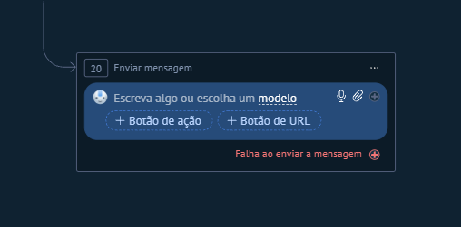
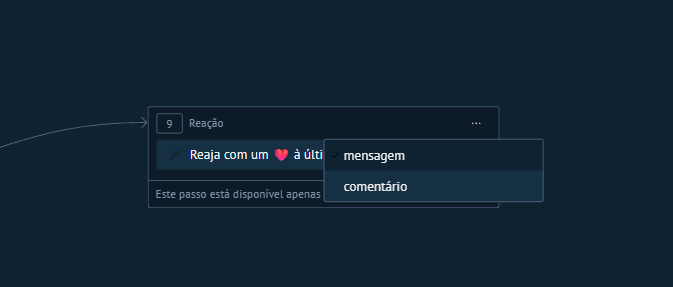
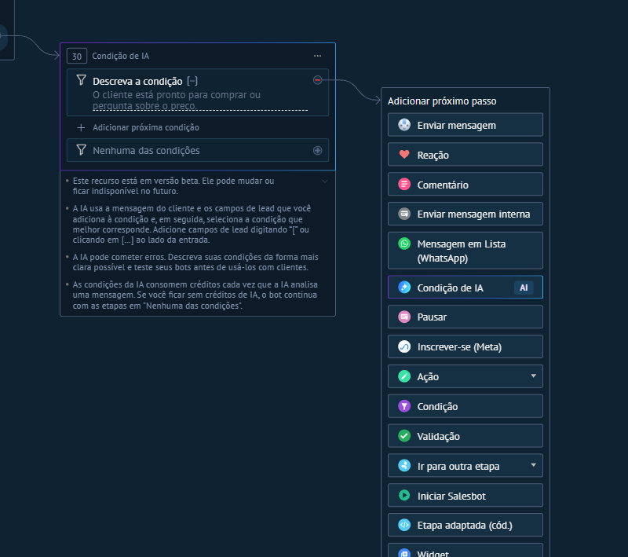
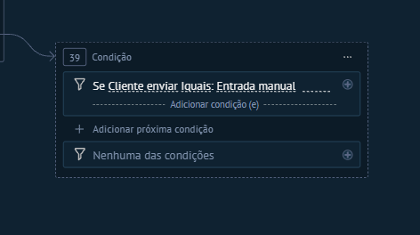
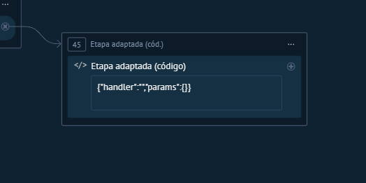

# Guia de Referência — 17 Passos do Salesbot Kommo
**Edição baseada nos prints enviados em 23/10/2026 | Kommo CRM + WhatsApp Business API**

> **Objetivo:** explicar cada passo do editor visual, mostrar o print correspondente, listar opções de configuração e propor usos comerciais avançados e combinações com outros passos.

> **Como ler a evidência:** **[PRINT]** = visível nos seus prints; **[OFICIAL]** = confirmado na documentação da Kommo; **[ESTRATÉGIA]** = exemplo de arquitetura recomendado, não uma opção nativa de menu. Nos passos sem captura do painel aberto, o recorte mostra apenas a entrada correspondente no menu. Isso evita inventar sub-opções.

## Índice

1. [Enviar mensagem](#1-enviar-mensagem)
2. [Reação](#2-reação)
3. [Comentário](#3-comentário)
4. [Enviar mensagem interna](#4-enviar-mensagem-interna)
5. [Mensagem em Lista (WhatsApp)](#5-mensagem-em-lista-whatsapp)
6. [Condição de IA](#6-condição-de-ia)
7. [Pausar](#7-pausar)
8. [Inscrever-se (Meta)](#8-inscrever-se-meta)
9. [Ação](#9-ação)
10. [Condição](#10-condição)
11. [Validação](#11-validação)
12. [Ir para outra etapa](#12-ir-para-outra-etapa)
13. [Iniciar Salesbot](#13-iniciar-salesbot)
14. [Etapa adaptada (cód.)](#14-etapa-adaptada-cód)
15. [Widget](#15-widget)
16. [Round Robin](#16-round-robin)
17. [Parar Salesbot](#17-parar-salesbot)
18. [Biblioteca de arquiteturas](#biblioteca-de-arquiteturas-reutilizáveis)
19. [Fontes e limitações](#fontes-e-limitações)

---

# 1. Enviar mensagem





## Opções de configuração disponíveis

**[PRINT]**
- `Escreva algo ou escolha um modelo`: insere texto livre ou seleciona um modelo pronto.
- Ícones visíveis: **microfone**, **anexo** e **adicionar**; aparecem conforme o tipo de composição do bloco.
- `+ Botão de ação`: inclui respostas guiadas; cada botão pode conduzir a uma ramificação.
- `+ Botão de URL`: cria um botão que abre um endereço.
- `Outra resposta`: caminho para texto diferente dos botões/sinônimos previstos.
- `Sem resposta`: caminho de ausência de retorno, geralmente associado a uma espera.
- `Falha ao enviar a mensagem`: tratamento separado de erro de envio.
- A captura de pré-visualização traz os canais **WhatsApp Business, WhatsApp Lite, Facebook, Instagram, Telegram, TikTok e Outros canais**. São destinos exibidos no simulador, não garantia de suporte idêntico a todos os formatos.

**[OFICIAL]**
- É possível inserir botões de resposta rápida, sinônimos de resposta e anexos (documento, imagem, vídeo e áudio, com regras por canal).
- É possível escolher destinatários: **todos os contatos** ou **contato principal**, usando **canais selecionados** ou **canal principal**.
- A Kommo documenta até **13 botões no editor**, mas recomenda em geral **até 3** para não comprometer a exibição em determinados canais.
- A continuidade principal e a ramificação de falha de envio devem ser tratadas separadamente.

## Possibilidades disruptivas

- **Qualificação progressiva:** perguntar objetivo, segmento e prazo em pequenas mensagens; gravar as respostas com **Ação → Definir campo** em vez de deixar dados soltos no chat.
- **Triagem com recuperação automática:** se a mensagem falhar, registrar uma tarefa para o time verificar número, canal, template e histórico do atendimento.
- **Venda consultiva multicanal:** apresentar escolhas que abrem páginas específicas; usar tags para medir quantos clientes escolheram cada opção.

## Dicas de outros passos que podem ser usados antes ou depois

**Antes:** `Condição` (segmento/canal) → `Enviar mensagem`.

**Depois:** `Pausar` (aguardar retorno) → `Validação` (qualidade do dado) → `Ação: Definir campo`.

**Tratamento de erro:** `Falha ao enviar a mensagem` → `Ação: Adicionar tarefa` → `Enviar mensagem interna` → `Parar Salesbot`.

**Métrica sugerida:** taxa de entrega e taxa de resposta por opção.

**Atenção técnica:** **WhatsApp API:** mensagens livres e interativas normalmente dependem da janela de atendimento aberta; fora dela, planeje a retomada com um template aprovado e com permissão adequada. Não assuma que um botão renderizado em outro canal terá o mesmo comportamento no WhatsApp.

---

# 2. Reação



## Opções de configuração disponíveis

**[PRINT]**
- Texto do bloco: `Reaja com um ❤️ à última ...` (emoji de coração mostrado no print).
- Menu de alvo da reação:
  - `mensagem`
  - `comentário`
- Existe um aviso inferior de restrição de disponibilidade, mas o canal completo não aparece na área capturada.

**[OFICIAL / LIMITAÇÃO]**
- O recurso permite criar reações em interações de canais compatíveis; a documentação consultada não fornece um inventário completo de emojis e restrições para cada canal.
- **Não há evidência**, neste print, de que o emoji possa ser trocado nem de que a reação de comentário funcione via WhatsApp API. Verifique no canal real antes de implementar.

## Possibilidades disruptivas

- **Reconhecimento instantâneo:** reagir a uma manifestação positiva enquanto outra etapa identifica se há intenção de compra.
- **Atendimento social sem ruído:** reagir a comentários ou mensagens relevantes sem disparar várias mensagens automáticas consecutivas.
- **Sinalização de recebimento:** criar uma experiência leve para interações rápidas em canais sociais, seguida de resposta quando pertinente.

## Dicas de outros passos que podem ser usados antes ou depois

**Antes:** gatilho por comentário ou `Condição` sobre conteúdo de mensagem.

**Depois:** `Comentário` (resposta pública, quando cabível) ou `Enviar mensagem` (continuidade), e `Parar Salesbot`.

**Métrica sugerida:** proporção de comentários com retorno humano e taxa de resposta após a interação.

**Atenção técnica:** A reação não substitui confirmação de recebimento transacional nem atendimento; confira o suporte do canal.

---

# 3. Comentário


## Opções de configuração disponíveis

**[PRINT]**
- Campo principal: `Escreva um comentário...`.
- Conector `+` para continuar o fluxo.
- Menu de mais opções `...` do bloco, sem conteúdo aberto no print.

**[OFICIAL]**
- A Kommo exemplifica esse passo para publicar **respostas públicas a comentários do Instagram**.
- A filtragem por palavra-chave normalmente ocorre antes, por um passo **Condição**; ela não aparece como submenu interno do bloco Comentário.
- Exige canal correspondente conectado e um gatilho apropriado de comentário.

## Possibilidades disruptivas

- **Conteúdo que gera conversa:** ao detectar comentário “CATÁLOGO”, publicar resposta curta e ativar outro fluxo de atendimento quando as regras do canal permitirem.
- **Moderação de intenção:** dar respostas diferentes a perguntas de preço, disponibilidade e dúvidas frequentes.
- **Campanhas mensuráveis:** usar tags diferentes conforme o tema do comentário para medir quais publicações originam oportunidades qualificadas.

## Dicas de outros passos que podem ser usados antes ou depois

**Antes:** gatilho de comentário → `Condição: comentário do cliente é igual/contém palavra-chave`.

**Depois:** `Comentário` → `Ação: Gerenciar tags` ou `Enviar mensagem` se o contexto e as permissões do canal permitirem → `Parar Salesbot`.

**Métrica sugerida:** comentários acionados → conversas iniciadas → leads qualificados.

**Atenção técnica:** Não confunda responder publicamente a um comentário com enviar uma mensagem privada: a segunda ação depende da integração e das políticas de mensagens do canal.

---

# 4. Enviar mensagem interna


## Opções de configuração disponíveis

**[PRINT]** A imagem disponível mostra **apenas a opção no menu**; não mostra os campos internos.

**[OFICIAL]**
- Conteúdo da mensagem destinada à equipe.
- Seleção de um ou vários usuários responsáveis/destinatários.
- Mensagem privada ao contexto de trabalho da Kommo, não enviada ao contato externo.
- Na linguagem de desenvolvedor, o handler `send_internal` admite mensagem, entidade/lead e identificação de usuário ou grupo; isto é uma **capacidade da API/linguagem**, não prova de todos esses campos no formulário visual.

## Possibilidades disruptivas

- **Escalonamento de alta intenção:** alertar pré-vendas quando um cliente informar “quero fechar hoje”.
- **Alertas operacionais contextuais:** avisar financeiro quando o cliente escolher segunda via ou confirmar comprovante.
- **Handoff sem perda de contexto:** combinar resposta do bot, tags e mensagem para orientar o consultor na próxima ação.

## Dicas de outros passos que podem ser usados antes ou depois

**Antes:** `Condição de IA` (classificação) ou `Mensagem em Lista` (setor escolhido) → `Ação: Definir campo`.

**Depois:** `Ação: Mudar usuário responsável` → `Ação: Adicionar tarefa` → `Parar Salesbot`.

**Métrica sugerida:** tempo entre alerta interno e primeira ação do responsável.

**Atenção técnica:** Para o passo visual, é necessário um print expandido para catalogar todos os seletores com precisão.

---

# 5. Mensagem em Lista (WhatsApp)


## Opções de configuração disponíveis

**[PRINT]**
- `Título da mensagem...` (opcional).
- `Mensagem...` (obrigatória).
- `Rodapé...` (opcional).
- `Nome do botão...` (obrigatório).
- `Título da seção...` (obrigatório).
- `Título da opção...` (obrigatório).
- `Descrição...` (opcional).
- `Adicionar opção` e `+ Adicionar seção`.
- Ramificações: `Outra resposta` e `Sem resposta`.

**[OFICIAL | atualizado em 16/10/2026]**
- Máximo **10 opções no total**, somadas todas as seções.
- Cada seção contém ao menos uma opção; seleção do cliente é única por lista.
- Título de seção: até **24 caracteres**; título de opção: até **24**; descrição: até **72**.
- Lista é **mensagem interativa**, não é template aprovado pela Meta.
- Disponível somente no **Salesbot**, com integração WhatsApp Business, **janela de 24 horas aberta** e requisitos de plano/permissão documentados (Avançado ou superior ou teste ativo; administrador).

## Possibilidades disruptivas

- **Central inteligente:** uma única lista de `Vendas`, `Suporte`, `Financeiro` e `Parcerias`, seguida de atribuição automática de setor e responsável.
- **Pré-qualificação de proposta:** perguntar faixa de investimento, categoria ou unidade de interesse sem exigir digitação.
- **Pós-venda escalável:** oferecer escolhas de status do pedido, devolução e ajuda técnica; registrar a categoria de atendimento.

## Dicas de outros passos que podem ser usados antes ou depois

**Antes:** `Enviar mensagem` (contextualizar e pedir permissão de seguir) ou receber mensagem do cliente para abrir a janela.

**Depois:** `Condição: mensagem do cliente é igual ao título exato da opção` → `Ação: Definir campo` → `Ação: Mudar status do lead` → `Round Robin`/`Mudar usuário responsável`.

**Fallback:** `Outra resposta` → `Enviar mensagem` de esclarecimento; `Sem resposta` → `Pausar`/`Adicionar tarefa`.

**Métrica sugerida:** escolhas por departamento e porcentagem resolvida sem humano.

**Atenção técnica:** **Regra crítica:** fora da janela de 24 horas a lista não é entregue. O fluxo correto é usar um template WhatsApp aprovado (quando autorizado), aguardar resposta do cliente e só então abrir a lista.

---

# 6. Condição de IA



## Opções de configuração disponíveis

**[PRINT — confirmado diretamente na interface]**
- `Descreva a condição`: entrada em linguagem natural, por exemplo: `O cliente está pronto para comprar ou pergunta sobre o preço`.
- `+ Adicionar próxima condição`: cria outras intenções ou critérios.
- `Nenhuma das condições`: fallback quando nenhum critério for escolhido.
- A descrição da interface informa que a IA usa **mensagem do cliente e campos de lead adicionados à condição**, selecionando a melhor correspondência.
- Pode inserir campos de lead pelo seletor acionado por `[` ou pelo botão de adição indicado.
- Aviso de **versão beta**: o recurso pode mudar ou ficar indisponível.
- Aviso de **créditos de IA**: a análise de mensagem consome créditos; se esgotarem, o bot segue pelo caminho `Nenhuma das condições`.
- A interface recomenda descrever critérios de forma clara e testar antes de usar com clientes.

**[LIMITAÇÃO]** Não há submenu externo aberto mostrando todas as opções de campo, modelo ou plano; não inventamos esses parâmetros.

## Possibilidades disruptivas

- **Roteamento por intenção sem palavra exata:** entender “preciso contratar agora”, “quanto custa?” e “quero um orçamento” como intenção comercial próxima.
- **Alerta de churn ou atrito:** classificar reclamação, urgência e pedido de cancelamento, escalando imediatamente à equipe correta.
- **Triage híbrida:** usar IA para compreender texto livre e, em seguida, regras determinísticas para mover etapa e registrar tags — evitando que a IA execute ações críticas sem confirmação.

## Dicas de outros passos que podem ser usados antes ou depois

**Antes:** `Enviar mensagem` com pergunta aberta → `Pausar: Até a mensagem recebida`.

**Depois:** ramo `Compra` → `Ação: Gerenciar tags` + `Adicionar tarefa`; ramo `Suporte` → `Iniciar Salesbot` especializado; ramo `Nenhuma das condições` → `Mensagem em Lista` ou humano.

**Boa arquitetura:** IA **interpreta**, `Condição/Validação` **conferem**, `Ação` **executa**.

**Métrica sugerida:** acurácia por intenção, percentual de fallback, custo por classificação e conversão após roteamento.

**Atenção técnica:** Crie sempre um caminho de contingência. Como o próprio painel avisa, crédito esgotado e falhas de classificação podem levar ao fallback.

---

# 7. Pausar


## Opções de configuração disponíveis

**[PRINT]** O dropdown revela **cinco opções**:
1. `Até a mensagem recebida`.
2. `Cronômetro`.
3. `Exceto durante o expediente`.
4. `Até o vídeo ser aberto`.
5. `Até o vídeo ser fechado`.

**[OFICIAL]**
- O `Cronômetro` aguarda intervalo definido (a documentação apresenta limite de até 8760 horas, 60 minutos e 60 segundos).
- O modo de expediente consulta o horário de trabalho configurado.
- Os eventos de vídeo **aberto/fechado** são restritos ao **Live Chat**, não ao WhatsApp.
- Pode-se configurar múltiplas condições de espera; o Salesbot segue o caminho do evento que ocorrer primeiro.

## Possibilidades disruptivas

- **SLA de atendimento:** se chegar resposta em 5 minutos, qualificar automaticamente; caso contrário, avisar o responsável.
- **Jornada respeitosa:** segurar comunicação fora do horário comercial e iniciar a próxima etapa no período operacional.
- **Follow-up controlado:** programar uma verificação ou tarefa após intervalo; evitando bombardear o cliente com mensagens.

## Dicas de outros passos que podem ser usados antes ou depois

**Antes:** `Enviar mensagem`/`Mensagem em Lista`.

**Depois (respondeu):** `Validação` → `Ação: Definir campo`.

**Depois (timer disparou):** `Ação: Adicionar tarefa` ou mensagem **somente se o canal ainda permitir** → `Parar Salesbot`.

**Métrica sugerida:** taxa de resposta em 5/15/60 minutos e tempo até handoff.

**Atenção técnica:** O cronômetro do Salesbot **não estende** a janela do WhatsApp API; qualquer mensagem programada precisa respeitar a elegibilidade no momento de envio.

---

# 8. Inscrever-se (Meta)


## Opções de configuração disponíveis

**[PRINT]**
- Escolha de destinatário e canais no cabeçalho (ex.: `Todos os contatos — canais selecionados`).
- Campos de `Título da mensagem...` e `#adicionar tags`.
- Texto de consentimento exibido na mensagem, como `Você deseja continuar recebendo nossas mensagens? Você pode cancelar a qualquer momento.`
- Controle `Permitir mensagens`.
- Caminhos `Outra resposta` e `Sem resposta`.
- Nota explicativa de que a funcionalidade serve a assinaturas para comunicações posteriores.

**[OFICIAL]**
- Exige integração **Facebook** conectada à página comercial.
- Dois campos principais exigidos: **tag** do lead e **título/tópico de inscrição**.
- O recurso é de **opt-in para canais Meta/Facebook compatíveis**, não um atalho geral para disparar mensagens WhatsApp fora das regras da API.

## Possibilidades disruptivas

- **Conteúdo recorrente consentido:** construir inscrição por tópico para novidades ou eventos em canais suportados.
- **Segmentação de interesse:** vincular inscrições a tags de interesse; equipes podem usar esses sinais para campanhas futuras conforme políticas aplicáveis.
- **Gestão de relevância:** reduzir mensagens não desejadas, enviando somente a temas selecionados.

## Dicas de outros passos que podem ser usados antes ou depois

**Antes:** `Condição` por canal (Facebook) → `Enviar mensagem` explicando o tema e a frequência.

**Depois:** `Ação: Gerenciar tags` de acordo com o retorno → `Pausar`/`Parar Salesbot`.

**Métrica sugerida:** taxa de adesão por tópico, cancelamentos e engajamento das comunicações.

**Atenção técnica:** **Não confundir com opt-in do WhatsApp Business API.** Consentimento e janela WhatsApp seguem regras próprias; a inscrição exibida não garante permissão de envio por WhatsApp.

---

# 9. Ação


## Opções de configuração disponíveis

**[PRINT]** A imagem recortada confirma a existência do passo `Ação` e da seta de submenu, mas não mostra a lista interna.

**[OFICIAL]** O guia do Salesbot descreve estas ações:

| Ação interna | Principais parâmetros/efeito |
|---|---|
| **Adicionar nota** | Entidade alvo e texto da anotação. |
| **Adicionar tarefa** | Responsável, tipo, vencimento e comentário. |
| **Alterar status da conversa** | Marcar conversa como respondida ou fechada. |
| **Mudar status do lead** | Selecionar funil e etapa de destino. |
| **Mudar usuário responsável** | Escolher usuário e entidade (lead, contato principal, todos os contatos, contato do chat ou empresa). |
| **Concluir tarefa** | Selecionar tarefas a concluir e critérios aplicáveis. |
| **Gerar formulário** | Criar formulário e definir campos; pode alimentar lead atual ou criar novo, conforme configuração. |
| **Criar lead** | Definir dados copiados/incluídos, responsável, funil e etapa. |
| **Gerenciar assinantes** | Adicionar/remover membros da equipe que acompanham o lead. |
| **Gerenciar tags** | Adicionar ou remover tags em entidades selecionadas. |
| **Meta Conversions API** | Acionar evento de conversão integrado à Meta, mediante integração/configuração. |
| **Enviar email** | Usar endereço de email conectado e modelo pré-criado. |
| **Enviar webhook** | Inserir URL de integração externa; tratar a resposta no sistema receptor. |
| **Definir campo** | Selecionar entidade, campo e origem do dado (p.ex., última mensagem ou entrada manual, conforme o campo). |

**Importante:** os rótulos exatos e subcampos do seu dropdown **ainda não foram fotografados**. A tabela acima é um inventário **documental**, não transcrição visual da sua conta.

## Possibilidades disruptivas

- **Lead autônomo:** ao identificar orçamento e prazo, preencher campos, atribuir uma pontuação externa e mover o lead para uma fila prioritária.
- **Integração orquestrada:** usar `Enviar webhook` para avisar n8n/ERP, calcular proposta ou consultar estoque; o sistema externo deve validar autenticação, duplicidades e consistência.
- **Rastreio de qualidade comercial:** gravar tags de intenção e eventos de conversão para comparar origem, qualificação e fechamento.
- **Operação sem esquecimentos:** gerar tarefa ao responsável sempre que o cliente pedir contato humano.

## Dicas de outros passos que podem ser usados antes ou depois

**Antes:** `Validação` (dado correto), `Condição` (regra determinística) ou `Condição de IA` (intenção).

**Depois:** `Enviar mensagem interna` para handoff, `Enviar mensagem` para confirmação, ou `Iniciar Salesbot` especializado.

**Mini-fluxo:** `Condição de IA: orçamento` → `Ação: Definir campo` → `Ação: Mudar status do lead` → `Ação: Adicionar tarefa` → `Parar Salesbot`.

**Métrica sugerida:** tarefas no prazo, precisão de dados gravados, tempo de ciclo entre etapas e taxa de conversão.

**Atenção técnica:** **Webhook ≠ resposta garantida.** Configure idempotência, autenticação, logs, alerta de falha e mecanismos de reprocessamento do lado do n8n/ERP. O bloco do Salesbot só expõe a chamada que a integração oferece.

---

# 10. Condição



## Opções de configuração disponíveis

**[PRINT]**
- Exemplo exibido: `Se Cliente enviar Iguais: Entrada manual`.
- `Adicionar condição (+)` dentro de um ramo.
- `+ Adicionar próxima condição` para outro ramo.
- `Nenhuma das condições` para fallback.
- A captura confirma comparação de entrada e operação `Iguais`, mas **não mostra o dropdown completo** de operadores/fontes.

**[OFICIAL]**
- Pode avaliar mensagem/chat, fonte do lead, código do chat ativo e campos personalizados disponíveis.
- Permite múltiplos ramos para resultados diferentes.
- As opções exatas de cada seletor dependem dos dados, campos e condições habilitados no ambiente.

## Possibilidades disruptivas

- **Roteamento por origem:** campanhas pagas seguem para equipe A; indicações seguem para atendimento de parceria.
- **Tratamento por dados existentes:** leads com campo `Plano` preenchido não repetem perguntas; os demais entram em enriquecimento de dados.
- **Antiduplos de comunicação:** verificar tag de campanha antes de reenviar materiais ou criar tarefas repetidas.

## Dicas de outros passos que podem ser usados antes ou depois

**Antes:** `Mensagem em Lista` para obter escolha, ou `Ação: Definir campo` para registrar contexto.

**Depois:** ramo aprovado → `Ação: Mudar etapa`; ramo não aprovado → `Enviar mensagem` explicativa; `Nenhuma das condições` → `Enviar mensagem interna`.

**Métrica sugerida:** distribuição entre ramos e queda de conversão por condição.

**Atenção técnica:** **Condição** compara dados/regras; **Validação** testa formato da resposta; **Condição de IA** interpreta intenção e pode consumir créditos. Escolha o bloco conforme o problema.

---

# 11. Validação


## Opções de configuração disponíveis

**[PRINT]** Apenas a entrada `Validação` foi capturada no menu.

**[OFICIAL]** Operadores documentados:
1. `É igual`.
2. `Não é igual`.
3. `Contém`.
4. `Não contém`.
5. `Tem um comprimento de`.
6. `Expressão regular (Regex)`.

Ao usar `Contém`, a Kommo documenta testes específicos de conteúdo como **números**, **letras**, **telefone**, **email** e **intervalo numérico**. A sintaxe detalhada e a interface de cada operador devem ser confirmadas no painel aberto.

## Possibilidades disruptivas

- **Cadastro limpo antes de vender:** validar telefone ou email antes de gravar no CRM, reduzindo retrabalho e contatos inválidos.
- **Pré-aprovação automatizada:** verificar código, CEP ou protocolo em formato esperado; consultar autenticidade em integração externa quando necessário.
- **Controle de respostas vazias:** impedir avanço para orçamento quando o cliente devolve resposta incompleta ou incompatível.

## Dicas de outros passos que podem ser usados antes ou depois

**Antes:** `Enviar mensagem: Informe seu email` → `Pausar: Até a mensagem recebida`.

**Depois (válido):** `Ação: Definir campo` → `Enviar mensagem` de confirmação.

**Depois (inválido):** `Enviar mensagem: Confira o formato` → `Ir para outra etapa` (retornar à pergunta).

**Métrica sugerida:** percentual de respostas válidas na primeira tentativa.

**Atenção técnica:** Regex verifica **formato**, não comprova que email, telefone ou documento realmente existem; quando necessário valide com serviço apropriado e permissão legal.

---

# 12. Ir para outra etapa


## Opções de configuração disponíveis

**[PRINT]** O item e a seta de submenu aparecem no menu.

**[OFICIAL]**
- Selecionar outra etapa **já existente** no Salesbot.
- Criar ligação para a etapa escolhida sem duplicar toda a sequência.
- A opção depende de haver uma etapa disponível como destino; o dropdown exato não aparece nos prints enviados.

## Possibilidades disruptivas

- **Módulo de correção reaproveitável:** qualquer validação inválida pode voltar ao mesmo bloco de coleta sem copiar telas.
- **Caminho único de handoff:** diferentes intenções convergem para a mesma sequência de atribuição e tarefa.
- **Fluxos menores e auditáveis:** caminhos de suporte, cobrança e comercial podem convergir em etapa de encerramento comum.

## Dicas de outros passos que podem ser usados antes ou depois

**Antes:** `Validação` ou `Condição` que exige retorno/reutilização.

**Depois:** bloco destino como `Enviar mensagem`, `Ação` ou `Parar Salesbot`.

**Métrica sugerida:** quantidade de retornos por lead e pontos com maior repetição.

**Atenção técnica:** Proteja loops: defina limite de tentativas, fallback humano e condição clara de saída. Uma volta sem saída pode impedir o encerramento do bot.

---

# 13. Iniciar Salesbot


## Opções de configuração disponíveis

**[PRINT]** O menu mostra o passo, mas o seletor de bots não foi aberto.

**[OFICIAL]**
- Escolher outro Salesbot já criado para ser iniciado no contexto do fluxo.
- Reutilizar um bot especializado dentro de outro.
- A Kommo documenta a continuidade do fluxo chamador após o bot auxiliar concluir, conforme o cenário exemplificado; o comportamento específico deve ser testado na configuração real.

## Possibilidades disruptivas

- **Arquitetura modular:** criar bots especializados (cadastro, pré-vendas, suporte, cobrança) em vez de um único fluxo gigante.
- **Padronização de unidades:** diferentes funis chamam o mesmo bot de validação cadastral.
- **Manutenção mais rápida:** atualizar regras de coleta em um só Salesbot, em vez de replicar em dezenas de automações.

## Dicas de outros passos que podem ser usados antes ou depois

**Antes:** `Condição`/`Mensagem em Lista` define o módulo necessário.

**Depois:** bot auxiliar executa cadastro → fluxo principal segue para `Ação: Mudar status do lead` ou `Enviar mensagem interna`.

**Métrica sugerida:** taxa de conclusão por bot auxiliar e número de pontos de manutenção reduzidos.

**Atenção técnica:** Evite bots que chamam uns aos outros circularmente. Faça testes de contexto, transferência e término.

---

# 14. Etapa adaptada (cód.)



## Opções de configuração disponíveis

**[PRINT]**
- Campo de edição de código.
- Estrutura inicial exibida: `{"handler":"","params":{}}`.
- Menu `...` do bloco.
- O print não mostra ferramentas de teste, autocomplete ou seleção de handlers.

**[OFICIAL | Documentação de desenvolvedores]**
- A etapa aceita comandos na **linguagem JSON do Salesbot** da Kommo.
- Conceitos da linguagem incluem `handler`, `params`, condições e ações.
- A documentação oficial apresenta handlers como `action`, `send_internal`, `goto`, `wait_answer`, `condition` e outros, cada qual com estrutura própria.

**Exemplo ilustrativo documentado — enviar mensagem interna vinculada ao lead:**
```json
{
  "handler": "send_internal",
  "params": {
    "entity_id": "{{lead.id}}",
    "entity_type": 2,
    "message": "Lead precisa de atendimento humano."
  }
}
```
> O exemplo é uma chamada de **linguagem Salesbot**, não de WhatsApp Cloud API. Valide no contexto da etapa e do handler suportado antes de produção.

## Possibilidades disruptivas

- **Automação sob medida:** tratar cenários que não possuem um bloco nativo na interface.
- **Reaproveitamento de dados:** compor mensagens e ações por placeholders, quando suportados pelo handler.
- **Controle fino de fluxo:** criar condições e saltos específicos para operações complexas já previstas na linguagem da Kommo.

## Dicas de outros passos que podem ser usados antes ou depois

**Antes:** `Validação` para evitar dados incompletos; `Condição` para controlar quando o código deve rodar.

**Depois:** `Ação: Adicionar nota` para auditoria ou `Enviar mensagem interna` em caso de tratamento operacional.

**Métrica sugerida:** taxa de sucesso da etapa, tempo para depuração e incidentes por mudança de código.

**Atenção técnica:** Não insira tokens, senhas ou segredos em scripts visíveis aos operadores. Para lógicas complexas ou com credenciais, prefira serviço externo seguro via webhook/API, com registro de execução.

---

# 15. Widget


## Opções de configuração disponíveis

**[PRINT]** O passo está no menu; não há print do catálogo de widgets ou da configuração de um widget específico.

**[OFICIAL]**
- Selecionar integração/widget disponível para execução dentro do Salesbot.
- Widgets instalados aparecem primeiro; a interface pode oferecer instalação de outros.
- Cada widget define seus próprios parâmetros (por exemplo, integrações de pagamento, notificação, consulta etc.).

**Não existe uma lista universal de sub-opções:** elas dependem do widget instalado e da versão do fornecedor.

## Possibilidades disruptivas

- **Cobrança dentro da jornada:** gerar link de pagamento por widget compatível, com retorno de status tratado em outros passos.
- **Ponte com software legado:** acionar um widget de agenda, faturas ou catálogo sem reimplementar toda a experiência.
- **Fluxo de atendimento especializado:** usar serviços prontos para enriquecer o lead ou abrir solicitações.

## Dicas de outros passos que podem ser usados antes ou depois

**Antes:** `Condição` (determinar elegibilidade) → `Validação` (coletar dado correto).

**Depois:** `Enviar mensagem` com instrução de próxima ação → `Ação: Definir campo`/`Adicionar tarefa`.

**Métrica sugerida:** sucesso e tempo médio da operação pelo widget.

**Atenção técnica:** Integração de terceiros requer avaliação de privacidade, escopos de acesso, suporte e custos. Consulte os campos reais do widget instalado.

---

# 16. Round Robin


## Opções de configuração disponíveis

**[PRINT]**
- Duas ramificações iniciais, ambas denominadas `Opção`.
- Ícone `+` ao lado de cada opção para inserir o próximo passo.
- `+ Adicionar outra opção`.
- Aviso: ao adicionar ou remover uma opção, **a fila é redefinida e começa do início**.

**[OFICIAL]**
- Distribuição **circular e sequencial**, não necessariamente aleatória.
- Mínimo de **2** ramificações, máximo de **100**.
- A distribuição também pode reiniciar por longos períodos de inatividade ou situações operacionais documentadas.
- Pode ser usado para variar mensagens, criar caminhos de atividades, alternar responsáveis ou construir testes A/B.

## Possibilidades disruptivas

- **Teste de scripts comerciais:** metade dos leads recebe um texto de abordagem A; outra metade, texto B, e você mede a taxa de agendamento.
- **Carga operacional equilibrada:** criar ramos para equipes ou responsabilidades diferentes, com cautela para ausências e capacidade individual.
- **Experimentos controlados:** comparar roteiros de qualificação mantendo origem, horário e perfil dos leads equivalentes.

## Dicas de outros passos que podem ser usados antes ou depois

**Antes:** `Condição` filtra leads elegíveis e impede clientes existentes de entrar no experimento.

**Depois (em cada ramo):** `Enviar mensagem` diferente → `Ação: Gerenciar tags` (`teste_A`/`teste_B`) → `Ação: Adicionar tarefa`.

**Métrica sugerida:** conversão por ramo e distribuição efetiva de leads.

**Atenção técnica:** A sequência circular ajuda no balanceamento, mas não considera automaticamente férias, disponibilidade ou carga por vendedor; complemente com regras de elegibilidade e gestão de responsabilidade.

---

# 17. Parar Salesbot


## Opções de configuração disponíveis

**[PRINT]** A opção `Parar Salesbot` aparece na lista; não há parâmetros internos exibidos.

**[OFICIAL]**
- Termina a execução daquele Salesbot.
- É apropriado ao final dos ramos que concluíram seu objetivo, realizaram handoff ou passaram por tratamento de falha.
- Não encerra necessariamente o lead, a conversa ou o negócio; esses estados exigem **Ações** específicas.

## Possibilidades disruptivas

- **Encerramento limpo:** separar concluir a conversa automatizada de fechar a oportunidade de vendas.
- **Proteção contra mensagens indevidas:** impedir que sequências adicionais continuem após o cliente pedir atendimento humano.
- **Retorno mensurável:** registrar tag/nota/status antes de encerrar, permitindo auditoria de como cada ramo terminou.

## Dicas de outros passos que podem ser usados antes ou depois

**Antes:** `Ação: Gerenciar tags`, `Mudar status do lead`, `Adicionar tarefa` ou `Enviar mensagem interna`.

**Depois:** não existe continuação naquele caminho do bot. A próxima interação depende de outro gatilho, bot ou ação humana.

**Métrica sugerida:** proporção dos leads que atingem encerramento esperado versus encerramento por fallback.

**Atenção técnica:** `Parar Salesbot` não é o mesmo que `Alterar status da conversa` nem `Mudar status do lead`.

---

# Biblioteca de arquiteturas reutilizáveis

As sequências abaixo são **propostas de implementação**. Os nomes entre parênteses representam a escolha de configuração de cada etapa. Ajuste gatilhos, textos, políticas de canal e permissões ao caso real.

## Arquitetura A — Qualificação no WhatsApp e distribuição para equipe

```text
[Cliente envia mensagem no WhatsApp]
    ↓
Enviar mensagem (boas-vindas / intenção)
    ↓
Mensagem em Lista (Vendas | Suporte | Financeiro)
    ↓
Condição (comparar título escolhido)
    ├── Vendas → Ação (tag "vendas") → Round Robin
    │                                  ├── Equipe A → Ação (responsável A)
    │                                  └── Equipe B → Ação (responsável B)
    │                                          ↓
    │                                   Adicionar tarefa
    │                                          ↓
    │                                   Enviar mensagem interna
    ├── Suporte → Iniciar Salesbot (suporte)
    └── Financeiro → Ação (responsável financeiro)
    ↓
Parar Salesbot
```

**Resultado pretendido:** organizar triagem, reduzir encaminhamento manual e medir conversão por setor.

**Critérios de teste:** janela de 24 horas aberta, opções escritas exatamente como na condição, tarefas criadas no usuário correto e distribuição sequencial verificada.

## Arquitetura B — Comentário do Instagram → oportunidade comercial

```text
[Gatilho: comentário em publicação]
    ↓
Condição (comentário contém palavra-chave)
    ├── Sim → Reação (se o canal suportar)
    │           ↓
    │         Comentário (resposta pública)
    │           ↓
    │         Ação (tag da campanha)
    │           ↓
    │         Enviar mensagem (apenas se permitido pela integração)
    └── Não → Parar Salesbot
```

**Resultado pretendido:** capturar o interesse sem tratar todos os comentários como leads qualificados.

**Critérios de teste:** respostas não duplicadas, reação suportada e separação entre público e privado.

## Arquitetura C — IA para triagem, regras para execução

```text
Enviar mensagem (O que você precisa resolver?)
    ↓
Pausar (Até a mensagem recebida)
    ↓
Condição de IA
    ├── "Quer comprar" → Ação (tag: quente)
    │                    → Ação (adicionar tarefa prioritária)
    ├── "Problema técnico" → Iniciar Salesbot (suporte)
    ├── "Financeiro" → Ação (mudar responsável)
    └── Nenhuma das condições → Enviar mensagem interna
                                → Parar Salesbot
```

**Resultado pretendido:** combinar linguagem natural com ações controláveis e auditáveis.

**Critérios de teste:** frases ambíguas, campos ausentes, esgotamento de créditos de IA e caminho de fallback.

## Arquitetura D — Kommo + n8n + sistema comercial externo

```text
Enviar mensagem (coleta de pedido)
    ↓
Pausar (receber dados)
    ↓
Validação (formato)
    ├── Inválido → Enviar mensagem (corrigir) → Ir para outra etapa
    └── Válido → Ação (definir campos)
                       ↓
                 Ação (enviar webhook ao n8n)
                       ↓
                 n8n / ERP processa a requisição
                       ↓
                 Atualização de status por integração separada*
                       ↓
                 Kommo aciona próximo atendimento pelo gatilho configurado
```

\* A atualização e o retorno **não acontecem automaticamente só porque um webhook foi enviado**: é preciso implementar a integração de retorno via API, webhooks, gatilhos ou outro mecanismo verificável.

**Resultado pretendido:** conectar o CRM ao processo real da empresa com log, autenticação, tentativas e idempotência.

## Checklist de homologação antes de ativar o bot

- [ ] Gatilho correto, sem reinícios inesperados e com condição de entrada bem definida.
- [ ] Canal e destinatário conferidos com **contato de teste real**.
- [ ] Mensagens de WhatsApp: janela de 24 horas, template e consentimento verificados.
- [ ] Todos os ramos **Outra resposta**, **Sem resposta**, **Falha ao enviar** e **Nenhuma das condições** tratados quando disponíveis.
- [ ] Campos gravados, tags e mudanças de etapa conferidos no cartão do lead.
- [ ] Testes de entrada inválida, ausência de resposta, respostas repetidas e canal indisponível.
- [ ] Alterações no Round Robin testadas para evitar distribuição inesperada.
- [ ] Fluxos de IA testados com mensagens ambíguas e falta de crédito.
- [ ] Webhooks autenticados, com observabilidade e capacidade de reprocessamento.
- [ ] Cada ramo termina com ação esperada e `Parar Salesbot` quando for apropriado.

# Fontes e limitações

## Evidência primária do projeto
- **13 screenshots do editor visual** enviados pelo usuário em 23/10/2026.
- **1 screenshot do menu geral** enviado anteriormente, com todos os 17 passos.
- Para os passos 4, 9, 11, 12, 13, 15 e 17, o guia apresenta **recortes do menu**, não capturas do submenu aberto. São os pontos que mais se beneficiariam de prints adicionais.

## Documentação oficial consultada
1. Kommo, **Salesbot: visão geral** (passos, validação, ação, pausa, widgets, limites de botões): https://support.kommo.com/docs/pt-br/salesbot-overview
2. Kommo, **Crie e use mensagens em Lista no WhatsApp Business**, atualizado em **16/10/2026** (limites de tamanho e janela de 24h): https://support.kommo.com/resources/docs/pt-br/create-a-list-message-in-whatsapp-business
3. Kommo, **Round Robin no Salesbot: visão geral**: https://support.kommo.com/docs/pt-br/round-robin-in-salesbot-overview
4. Kommo, **Use o recurso de mensagens de opt-in da Meta**: https://support.kommo.com/docs/pt-br/use-metas-opt-in-feature-for-messaging
5. Kommo Developers, **Salesbot in Digital Pipeline / linguagem JSON**: https://developers.kommo.com/docs/salesbot-dp
6. Kommo, **Crie um Salesbot na Kommo**: https://support.kommo.com/docs/pt-br/create-a-salesbot-in-kommo
7. Kommo, **Visão geral dos modelos de WhatsApp**: https://support.kommo.com/docs/pt-br/whatsapp-templates-overview-1

## Distinções necessárias
- **Limitações de canal**: Instagram, Facebook, WhatsApp Business, WhatsApp Lite, Telegram e outros podem disponibilizar recursos diferentes.
- **Variações de conta**: plano, permissões, integrações instaladas e atualizações da Kommo afetam os seletores que aparecem no editor.
- **Ideias de uso** não significam que existe um botão nativo para executá-las de ponta a ponta; algumas requerem etapas adicionais, integrações ou desenvolvimento.
- **Condição de IA** foi documentada principalmente a partir do print do usuário, pois sua ajuda embutida descreve beta, comparação semântica e consumo de créditos; não foram presumidos modelos ou parâmetros internos não fotografados.
- **Mensagens em Lista** não substituem templates aprovados fora da janela de 24 horas.

---
**Versão:** 1.0 • **Referência visual:** 23/10/2026 • **Uso:** implementação, treinamento e documentação de workflows Kommo.
