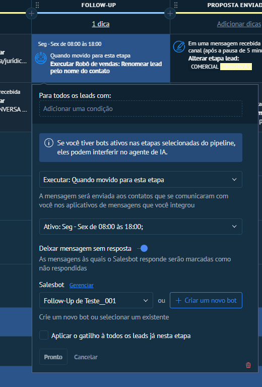
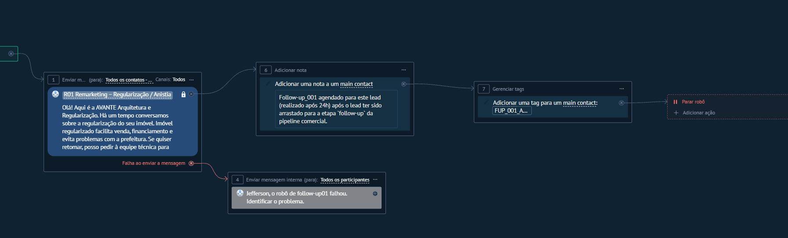
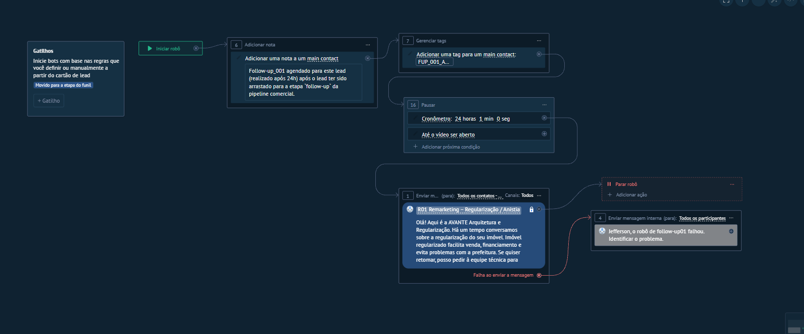

# Qual gatilho escolher?

Escolha pelo evento de negócio, elegibilidade, canal e exclusões; confirme plano e origem do evento. Biblioteca manual pode ficar sem gatilho automático; isso não impede início via API/outro bot quando suportado. Verifique duplicidade, dono, parada e lead controlado antes de ativar.

Pré-requisitos: autorização, plano/canal, evento e teste controlado.
Origem: [ficha de nó](../salesbot/NODE-KOMMO-013.md). Status: documentado, não homologado.

