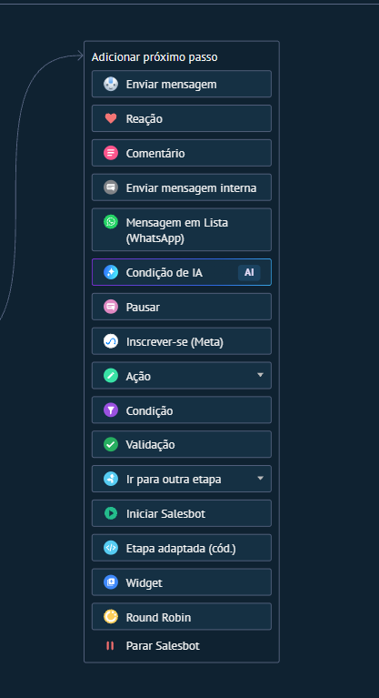

# UI-KOMMO-001 — 00 menu de passos

Origem: `recursos do kommo/Guia_Salesbot_Kommo_2026/imagens/00_menu_de_passos.png`. SHA-256: `67f7633c4f4c3fd1b8cb3cba5672766961e202529d3b38d81c30da61e59bcabb`.
Data de recebimento: 2026-10-23; data da captura e conta/plano: desconhecidas.

Status: fornecida, sem homologação operacional. Não extrapolar opções fora da área capturada nem disponibilidade entre canais/planos.

Consulta: [guia original](../../../recursos do kommo/Guia_Salesbot_Kommo_2026/Guia_Salesbot_Kommo.md).
Para opções confirmadas textualmente, consultar a ficha do nó correspondente; a indexação do nome do arquivo não é inspeção visual.
