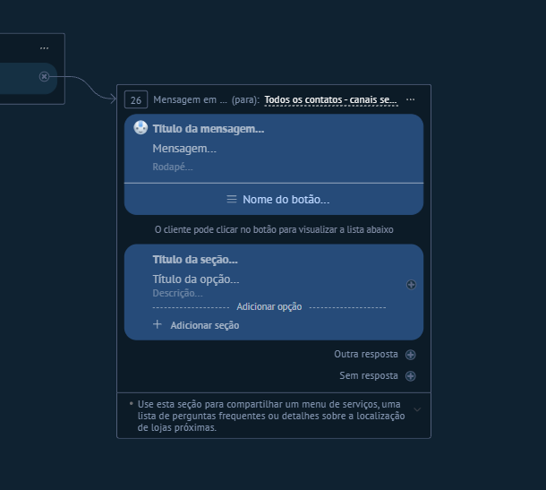

# UI-KOMMO-007 — 05 mensagem lista

Origem: `recursos do kommo/Guia_Salesbot_Kommo_2026/imagens/05_mensagem_lista.png`. SHA-256: `482e47a85c46bde821d8a949ca327426f704d13baa144eb76e724bc2d9ff0956`.
Data de recebimento: 2026-10-23; data da captura e conta/plano: desconhecidas.

Status: fornecida, sem homologação operacional. Não extrapolar opções fora da área capturada nem disponibilidade entre canais/planos.

Consulta: [guia original](../../../recursos do kommo/Guia_Salesbot_Kommo_2026/Guia_Salesbot_Kommo.md).
Para opções confirmadas textualmente, consultar a ficha do nó correspondente; a indexação do nome do arquivo não é inspeção visual.
