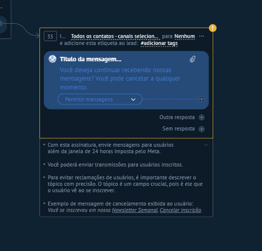

# UI-KOMMO-010 — 08 inscrever meta expandido

Origem: `recursos do kommo/Guia_Salesbot_Kommo_2026/imagens/08_inscrever_meta_expandido.png`. SHA-256: `34228bfce6af2480ab6c0c768585374351e61afc01264586b99e9d0318601b2a`.
Data de recebimento: 2026-10-23; data da captura e conta/plano: desconhecidas.

Status: fornecida, sem homologação operacional. Não extrapolar opções fora da área capturada nem disponibilidade entre canais/planos.

Consulta: [guia original](../../../recursos do kommo/Guia_Salesbot_Kommo_2026/Guia_Salesbot_Kommo.md).
Para opções confirmadas textualmente, consultar a ficha do nó correspondente; a indexação do nome do arquivo não é inspeção visual.
