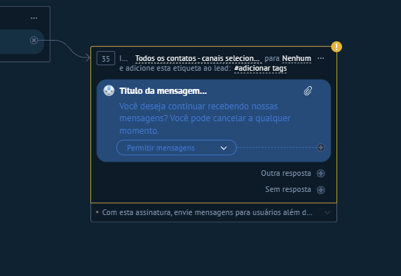

# UI-KOMMO-011 — 08 inscrever meta resumo

Origem: `recursos do kommo/Guia_Salesbot_Kommo_2026/imagens/08_inscrever_meta_resumo.png`. SHA-256: `7206a2683fa963314832b2745596d370844e5e9ad35c8bceb2c115e1eb5e59e7`.
Data de recebimento: 2026-10-23; data da captura e conta/plano: desconhecidas.

Status: fornecida, sem homologação operacional. Não extrapolar opções fora da área capturada nem disponibilidade entre canais/planos.

Consulta: [guia original](../../../recursos do kommo/Guia_Salesbot_Kommo_2026/Guia_Salesbot_Kommo.md).
Para opções confirmadas textualmente, consultar a ficha do nó correspondente; a indexação do nome do arquivo não é inspeção visual.
