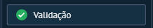

# UI-KOMMO-014 — 11 validacao menu

Origem: `recursos do kommo/Guia_Salesbot_Kommo_2026/imagens/11_validacao_menu.png`. SHA-256: `b57b28a3b2d84f214832424cf94afd0b63efd24d3da1669fc3ad1e6265bdf690`.
Data de recebimento: 2026-10-23; data da captura e conta/plano: desconhecidas.

Status: fornecida, sem homologação operacional. Não extrapolar opções fora da área capturada nem disponibilidade entre canais/planos.

Consulta: [guia original](../../../recursos do kommo/Guia_Salesbot_Kommo_2026/Guia_Salesbot_Kommo.md).
Para opções confirmadas textualmente, consultar a ficha do nó correspondente; a indexação do nome do arquivo não é inspeção visual.
