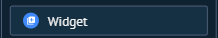

# UI-KOMMO-018 — 15 widget menu

Origem: `recursos do kommo/Guia_Salesbot_Kommo_2026/imagens/15_widget_menu.png`. SHA-256: `6fe1b586db4d08e57cf6b0fbda4482a75ec1c9514eee71c6c38525e91fc7af97`.
Data de recebimento: 2026-10-23; data da captura e conta/plano: desconhecidas.

Status: fornecida, sem homologação operacional. Não extrapolar opções fora da área capturada nem disponibilidade entre canais/planos.

Consulta: [guia original](../../../recursos do kommo/Guia_Salesbot_Kommo_2026/Guia_Salesbot_Kommo.md).
Para opções confirmadas textualmente, consultar a ficha do nó correspondente; a indexação do nome do arquivo não é inspeção visual.
