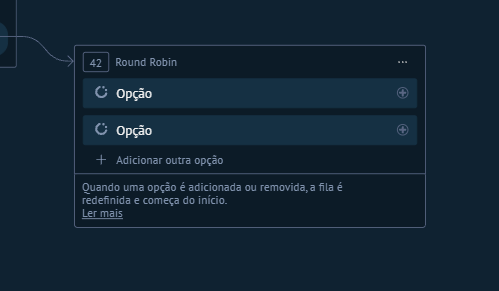

# UI-KOMMO-019 — 16 round robin

Origem: `recursos do kommo/Guia_Salesbot_Kommo_2026/imagens/16_round_robin.png`. SHA-256: `5a0b82c70e4767c78d9f4969c94bfc2e4756a70c37bb584a65832f3cec0d1009`.
Data de recebimento: 2026-10-23; data da captura e conta/plano: desconhecidas.

Status: fornecida, sem homologação operacional. Não extrapolar opções fora da área capturada nem disponibilidade entre canais/planos.

Consulta: [guia original](../../../recursos do kommo/Guia_Salesbot_Kommo_2026/Guia_Salesbot_Kommo.md).
Para opções confirmadas textualmente, consultar a ficha do nó correspondente; a indexação do nome do arquivo não é inspeção visual.
