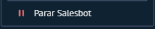

# UI-KOMMO-020 — 17 parar salesbot menu

Origem: `recursos do kommo/Guia_Salesbot_Kommo_2026/imagens/17_parar_salesbot_menu.png`. SHA-256: `1bcde86fa5053c6b596e79b5faa6c5bcb1763362131512e4797999e37f136d69`.
Data de recebimento: 2026-10-23; data da captura e conta/plano: desconhecidas.

Status: fornecida, sem homologação operacional. Não extrapolar opções fora da área capturada nem disponibilidade entre canais/planos.

Consulta: [guia original](../../../recursos do kommo/Guia_Salesbot_Kommo_2026/Guia_Salesbot_Kommo.md).
Para opções confirmadas textualmente, consultar a ficha do nó correspondente; a indexação do nome do arquivo não é inspeção visual.
