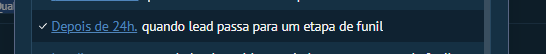

# UI-KOMMO-023 — Captura de tela 2026-10-23 153832

Origem: `recursos do kommo/interface (screenshots)/salesbot_bots_automacoes/opcoes_gatilhos/Captura de tela 2026-10-23 153832.png`. SHA-256: `1563fd88b8282ef43fe988a7f1f1e68ed18f8b217f1c5e7bbba1c0f55af03445`.
Data de recebimento: 2026-10-23; data da captura e conta/plano: desconhecidas.

Status: fornecida, sem homologação operacional. Não extrapolar opções fora da área capturada nem disponibilidade entre canais/planos.

Consulta: [guia original](../../../recursos do kommo/Guia_Salesbot_Kommo_2026/Guia_Salesbot_Kommo.md).
Para opções confirmadas textualmente, consultar a ficha do nó correspondente; a indexação do nome do arquivo não é inspeção visual.
