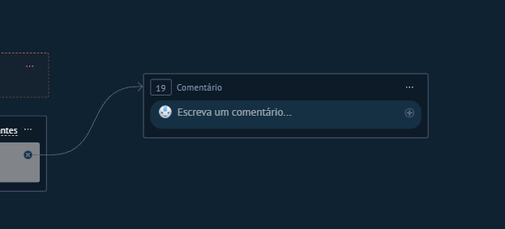

# UI-KOMMO-027 — Captura de tela 2026-10-23 155424

Origem: `recursos do kommo/interface (screenshots)/salesbot_bots_automacoes/passos_salesbot/Captura de tela 2026-10-23 155424.png`. SHA-256: `d15e1ef0cacd69ef3c17f7c808f7b97cc0d23748f2e6baee0d8ca2e084e18eef`.
Data de recebimento: 2026-10-23; data da captura e conta/plano: desconhecidas.

Status: fornecida, sem homologação operacional. Não extrapolar opções fora da área capturada nem disponibilidade entre canais/planos.

Consulta: [guia original](../../../recursos do kommo/Guia_Salesbot_Kommo_2026/Guia_Salesbot_Kommo.md).
Para opções confirmadas textualmente, consultar a ficha do nó correspondente; a indexação do nome do arquivo não é inspeção visual.
