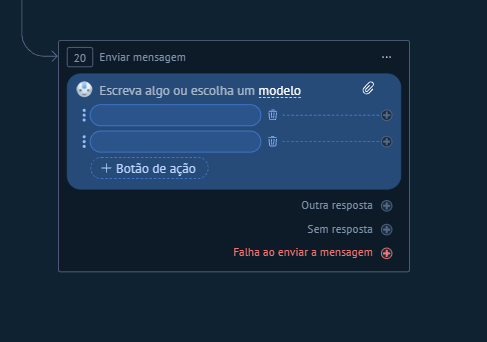

# UI-KOMMO-029 — Captura de tela 2026-10-23 155447

Origem: `recursos do kommo/interface (screenshots)/salesbot_bots_automacoes/passos_salesbot/Captura de tela 2026-10-23 155447.png`. SHA-256: `0fd9bb4befac5a827ae052a6ea80bb73b1105a18edd9fea2adbe860661504c30`.
Data de recebimento: 2026-10-23; data da captura e conta/plano: desconhecidas.

Status: fornecida, sem homologação operacional. Não extrapolar opções fora da área capturada nem disponibilidade entre canais/planos.

Consulta: [guia original](../../../recursos do kommo/Guia_Salesbot_Kommo_2026/Guia_Salesbot_Kommo.md).
Para opções confirmadas textualmente, consultar a ficha do nó correspondente; a indexação do nome do arquivo não é inspeção visual.
