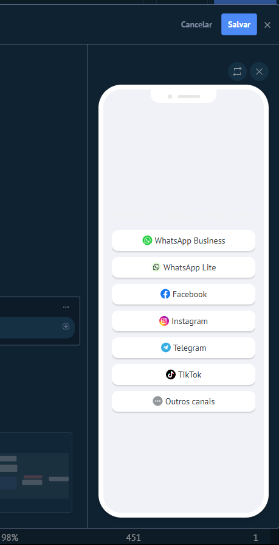

# UI-KOMMO-038 — Captura de tela 2026-10-23 155824

Origem: `recursos do kommo/interface (screenshots)/salesbot_bots_automacoes/passos_salesbot/Captura de tela 2026-10-23 155824.png`. SHA-256: `e073ac87a94fae0498ebc4ed9bb65ef9caa5d361007f96261599d4dc8d0160ca`.
Data de recebimento: 2026-10-23; data da captura e conta/plano: desconhecidas.

Status: fornecida, sem homologação operacional. Não extrapolar opções fora da área capturada nem disponibilidade entre canais/planos.

Consulta: [guia original](../../../recursos do kommo/Guia_Salesbot_Kommo_2026/Guia_Salesbot_Kommo.md).
Para opções confirmadas textualmente, consultar a ficha do nó correspondente; a indexação do nome do arquivo não é inspeção visual.
