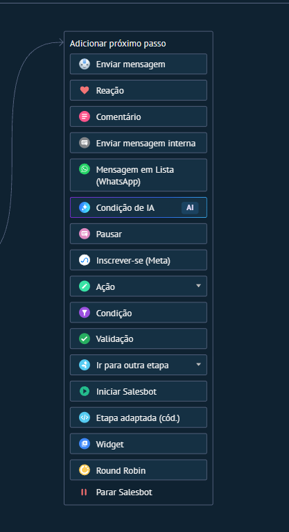

# UI-KOMMO-039 — salesbot passos

Origem: `recursos do kommo/interface (screenshots)/salesbot_bots_automacoes/passos_salesbot/salesbot_passos.png`. SHA-256: `04b0e0b3096911200ed313cd53f9b26a396ce30d3ce887c5684ebcf0c2e79430`.
Data de recebimento: 2026-10-23; data da captura e conta/plano: desconhecidas.

Status: fornecida, sem homologação operacional. Não extrapolar opções fora da área capturada nem disponibilidade entre canais/planos.

Consulta: [guia original](../../../recursos do kommo/Guia_Salesbot_Kommo_2026/Guia_Salesbot_Kommo.md).
Para opções confirmadas textualmente, consultar a ficha do nó correspondente; a indexação do nome do arquivo não é inspeção visual.
